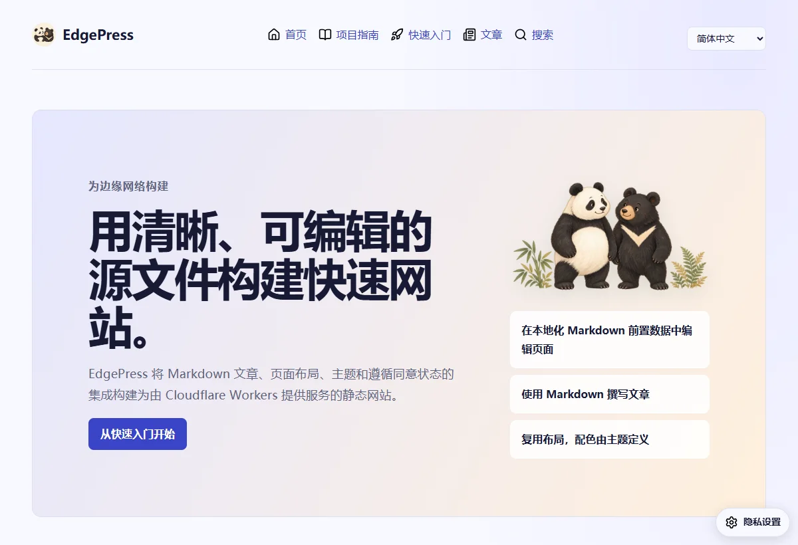

# 写文建站（EdgePress）中文说明

EdgePress 把 Markdown 文章和 JSON 页面生成静态网站，英文界面使用 EdgePress，中文界面使用“写文建站”。首页、文章页、目录、本地搜索和多语言路由都打包在静态产物里，不需要数据库。



## 零依赖与加载优化

- **零运行时依赖**：构建器直接运行在 Node.js 22.12+，自带 YAML、Markdown、HTML 清理、CSS/JS 压缩、图片尺寸检测、版本对比和本地预览服务器。云平台不用花时间装一堆第三方依赖包。
- **按用字裁剪字体**：构建时扫描全站实际出现的字符，只保留用到的本地 Noto `.woff2` 字体子集，大幅减少部署体积和传输流量。
- **按页面按需注入脚本**：代码复制、图片灯箱、语言切换等脚本只在页面确实用到时才引入。
- **自动展示最近一次修改**：结合 Git 历史自动生成“修改前／修改后”对比卡片，并给变动的本地图片生成哈希快照。如果不想在某篇文章显示，在前置属性里加上 `showChanges: false`。


## 本地开始

先确认本机安装了 Node.js 22.12 或更新版本：

```sh
mkdir my-edgepress-site
cd my-edgepress-site
npm install edgepress
npx edgepress init
npx edgepress s
```

日常写作只需要几条命令：

- `edgepress status`：查看当前站点、主题、语言和文章数量。
- `edgepress new "我的第一篇文章"`：在 `content/posts/` 新建文章，打开输出路径并在第二个 `---` 后面写 Markdown。
- `edgepress s`：启动内置本地预览，在 `http://127.0.0.1:8787/` 点击“编辑 Pages”即可拖拽调整页面布局。
- `edgepress g`：生成静态文件到 `dist/`（不要手动修改 `dist/`）。
- `edgepress theme list` / `edgepress theme use <主题名>`：查看或切换 `default`、`atelier`、`signal`、`folio` 四套主题。

图片放进 `content/assets/images/`，在文章里直接引用 `/images/photo.webp`。发布前记得在 `config.yml` 里填好你自己的网址、站点名称和隐私联系信息。

## 免费平台与 VPS 部署

完整额度来源见 [平台比较](platforms.md)。静态网站优先选 Cloudflare Workers 或腾讯 EdgeOne Pages；个人非商业站点也可选 Vercel；Netlify 免费额度按积分扣费；阿里云 ESA Pages 需先在控制台核对静态流量套餐。

| 平台 | 仓库配置文件 | 本地部署命令 |
| --- | --- | --- |
| Cloudflare | `wrangler.jsonc` | `npm run deploy:cloudflare` |
| 腾讯 EdgeOne Pages | `edgeone.json` | `npm run deploy:edgeone -- -n my-site` |
| Vercel | `vercel.json` | `npm run deploy:vercel` |
| Netlify | `netlify.toml` | `npm run deploy:netlify` |
| 阿里云 ESA Pages | `esa.jsonc` | `npm run deploy:esa -- --name my-site` |

统一使用 `npm run build` 构建，输出目录为 `dist/`。要部署到自己的 VPS，在私有 `config.yml` 中配置 `deploy.vps`（多节点用 `deploy.vpsTargets`），先跑 `edgepress d --dry-run` 检查文件，确认无误再跑 `edgepress d`（详见 [agent.md](../../agent.md)）。

## 可选外部服务与隐私

文章正文支持独立一行写 `!embed[youtube](https://www.youtube.com/watch?v=jNQXAC9IVRw)` 或 `!embed[ishare](...)`。在 `config.yml` 的 `plugins.consent.services` 登记对应服务后，页面会先显示占位提示，等访客点击同意后才加载第三方内容。评论系统可使用独立的 [iask（我提问）](https://github.com/jsw-teams/iask/blob/main/docs/zh-CN.md)，私钥只保留在独立后端里。
